# C++ ML Inference Server

[](https://github.com/Agent-Twilight7/cpp-ml-inference-server/actions/workflows/ci.yml)

A GPU model-serving server written from scratch in C++20, in the spirit of
NVIDIA Triton: a custom **epoll HTTP/1.1 stack**, **dynamic batching**,
**lock-free memory pools** with pinned host memory, ONNX Runtime execution on
CPU or **CUDA**, built-in **p50/p99 latency, throughput, queue-depth and
batch-size metrics** (JSON + Prometheus), graceful shutdown, Docker images
and CI with sanitizers.

**Highlights** (ResNet-18 on one RTX 4060 Laptop GPU; details in [Results](#results)):

- **3× the sustainable load at the same tail latency:** 1,500 req/s at p99 ≤ 30 ms
  with dynamic batching vs ~500 req/s without; peak ~1,800 req/s (2.7×).
- **No networking or concurrency libraries:** multi-reactor edge-triggered
  `epoll`, `SO_REUSEPORT` listeners, cross-thread completion via `eventfd`.
- **Lock-free where it matters:** Treiber-stack buffer pool with ABA tagging,
  wait-free HDR-style histograms, no locks on the metrics hot path.
- **Measured, not guessed:** an open-loop (coordinated-omission-safe) C++ load
  generator; profiling via the server's own metrics found a **30 ms-per-batch
  ONNX Runtime shape-change penalty** whose fix raised throughput 4×.
- **Tested:** 58 GoogleTest tests over real sockets and a fake model, clean
  under **AddressSanitizer, UBSan and ThreadSanitizer**, in GitHub Actions CI.

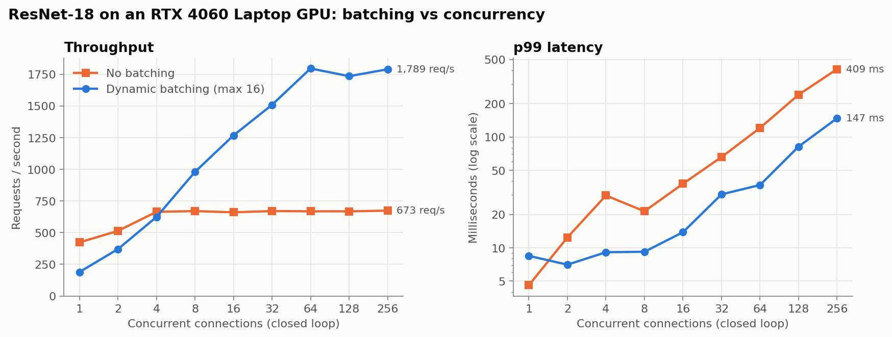

---

## Web demo

Start the server with `--web web` and open it in a browser:

```bash
./build-cuda/inference_server --device cuda --port 8080 --web web
# open http://localhost:8080/
```

- **Classify an image:** drop in any photo. The browser does the standard
  ImageNet preprocessing (resize, center-crop 224×224, normalize) and sends the
  tensor to `/v1/infer`, then shows the top-5 classes along with the batch size,
  queue wait and model time for that request.
- **Stress test:** pick 1 to 256 simultaneous users and press *Run*. Browsers
  only open ~6 connections per site, too few to show batching, so the server
  launches the bundled C++ `loadgen` against itself.
- **Live dashboard:** throughput, p50/p99 latency, average batch size, queue
  depth and the batch-size distribution, polled from `/stats` every second.
  With 1 user every batch holds one image; at 64 users batches fill to 16 and
  throughput jumps to ~1,800 req/s.

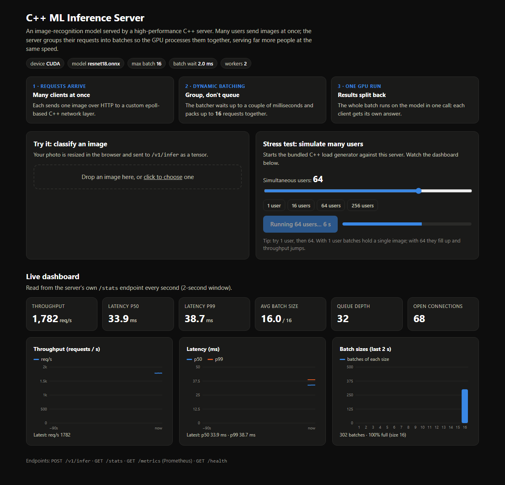

---

## Contents

- [Web demo](#web-demo)
- [Results](#results)
- [Why batching?](#why-batching)
- [Architecture](#architecture)
  - [Target design](#target-design)
  - [Network layer](#network-layer-srcnet)
  - [Dynamic batcher](#dynamic-batcher-srcbatching)
  - [Memory: pools and the data path](#memory-pools-and-the-data-path-srcmemory)
  - [Metrics](#metrics-srcmetrics-srcserver)
  - [Model runtime](#model-runtime-srcruntime)
  - [Graceful shutdown](#graceful-shutdown)
- [API](#api)
- [Build and run](#build-and-run)
- [Deployment: Docker, Prometheus, Grafana, CI](#deployment-docker-prometheus-grafana-ci)
- [Benchmarking](#benchmarking)
- [Testing](#testing)
- [Project layout](#project-layout)
- [Design lessons](#design-lessons)
- [Limitations and future work](#limitations-and-future-work)
- [Roadmap](#roadmap)

---

## Results

All numbers: ResNet-18 (224×224, FP32) on one **RTX 4060 Laptop GPU**, server
and load generator on the same machine (WSL2, 24 logical cores). Every request
carries one 602 KB image. Measured with the bundled C++ load generator
(`loadgen`) via `bench/run_benchmarks.py`; raw data is in `bench/results/`.
"No batching" is the same server with `--max-batch 1 --workers 4`. "Dynamic
batching" is `--max-batch 16 --max-delay-us 2000 --workers 2`. (Chart at the
top of this page.)

**Closed loop** (each connection sends its next request when the last one
returns):

| Connections | No batching | Dynamic batching | p99, no batching | p99, batching |
|---:|---:|---:|---:|---:|
| 1 | 423 req/s | 189 req/s | 4.6 ms | 8.5 ms |
| 8 | 670 req/s | 979 req/s | 21.3 ms | 9.2 ms |
| 16 | 660 req/s | 1,267 req/s | 37.8 ms | 13.8 ms |
| 64 | 668 req/s | **1,795 req/s (2.7×)** | 120.5 ms | **36.8 ms** |
| 256 | 673 req/s | 1,789 req/s | 408.8 ms | 147.4 ms |

Unbatched throughput flattens at ~670 req/s from 4 connections on; after that,
extra clients only add queueing delay. Batching keeps scaling to ~1,800 req/s.
At **a single connection batching is slower** (189 vs 423 req/s): a lone
request waits out the 2 ms delay hoping for company that never comes. Batching
trades a small latency cost at idle for capacity under load.

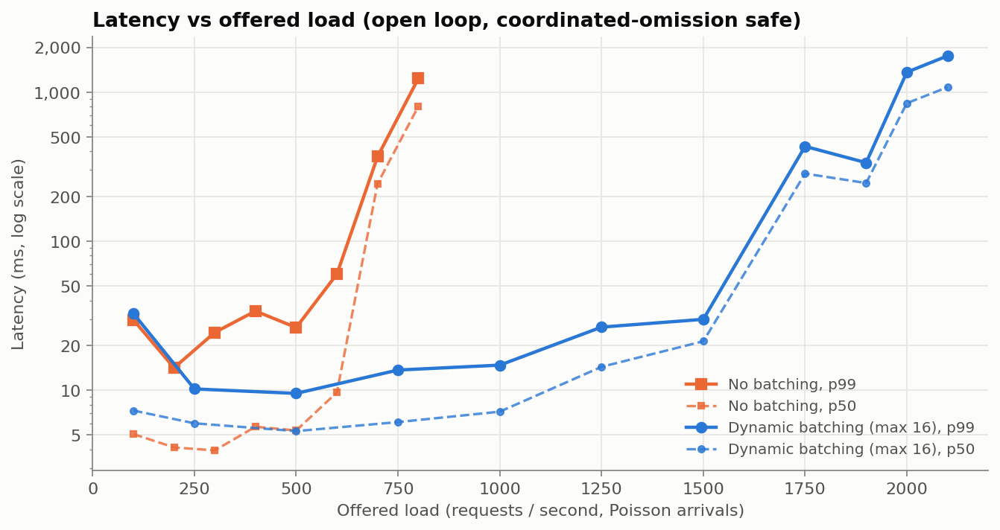

**Open loop** (Poisson arrivals at a fixed rate; latency measured from each
request's *scheduled* send time, so stalls aren't hidden):

| Offered load | No batching p50 / p99 | Dynamic batching p50 / p99 | Avg batch |
|---:|---:|---:|---:|
| 500 req/s | 5.4 / 26.3 ms | 5.3 / 9.5 ms | 2.6 |
| 600 req/s | 9.7 / 60.2 ms | — | — |
| 700 req/s | **243.7 / 370.0 ms** (saturated) | — | — |
| 1,000 req/s | — | 7.2 / 14.7 ms | 4.2 |
| 1,500 req/s | — | **21.3 / 29.9 ms** | 12.8 |
| 1,750 req/s | — | 284.1 / 432.6 ms (saturated) | 16.0 |

**With a p99 target of 30 ms, batching sustains 1,500 req/s against ~500 req/s
unbatched: 3× the capacity at the same tail latency.** Batch size adapts by
itself: ~2.6 requests per batch at 500 req/s, ~13 at 1,500 req/s.

At very low load (100 req/s) both configurations show ~30 ms p99. Requests that
sparse let the laptop GPU drop to low clocks between them. This is a power
management effect, not queueing.

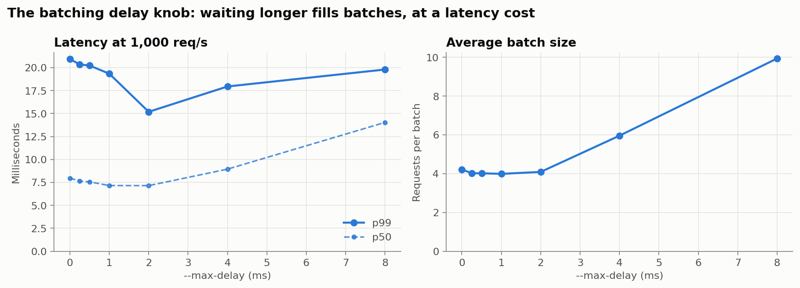

**The `--max-delay` knob** (open loop, 1,000 req/s): with two workers, batches
already form *while the GPU is busy*, so delays up to 2 ms barely change batch
size (~4). Beyond that, waiting fills batches (10 at 8 ms) but raises median
latency. The default of 2 ms had the lowest p99 (15.2 ms).

**CPU** (4 workers × 4 threads, 32 connections): 126 req/s without batching,
133 with. As predicted by [the per-batch timings](#why-batching), batching
buys almost nothing on CPU, where convolutions are compute-bound at any batch
size.

**Optimization history**, GPU at 64 concurrent clients (early phases used a
Python client, so treat cross-phase numbers as indicative):

| Step | Throughput | p99 |
|---|---:|---:|
| Unbatched baseline (Phase 2/3) | 665 req/s | 126 ms |
| + dynamic batching with batch-size buckets (Phase 3) | 1,537 req/s | 49 ms |
| + pinned, pooled memory (Phase 4) | 1,912 req/s | 42 ms |

The batch-size bucket fix mattered most at moderate load, where batch sizes
vary from run to run. At 16 clients it took batched throughput from 297 to
1,184 req/s ([details](#model-runtime-srcruntime)). At 64 clients batches are
almost always full (same shape), so it changed little there.

---

## Why batching?

Measured with `ort_smoke` (ResNet-18, one ONNX Runtime call per batch):

| Batch | CPU, 4 threads: ms/image | GPU (RTX 4060 Laptop): ms/image | GPU images/s |
|------:|------:|------:|------:|
| 1  | 14.8 | 3.53 | 283 |
| 4  | 14.2 | 0.90 | 1,116 |
| 16 | 14.6 | 0.59 | **1,698** |
| 64 | —    | 0.64 | 1,574 |

On CPU the per-image cost is flat: the convolutions are compute-bound, so a
batch has nothing to amortize. On the GPU, a single image leaves most of the
chip idle; running 16 together gives **6× the throughput**.

But clients send one image each. The server's job is to turn many concurrent
single-image requests into GPU-sized batches without making anyone wait long.
That is dynamic batching:

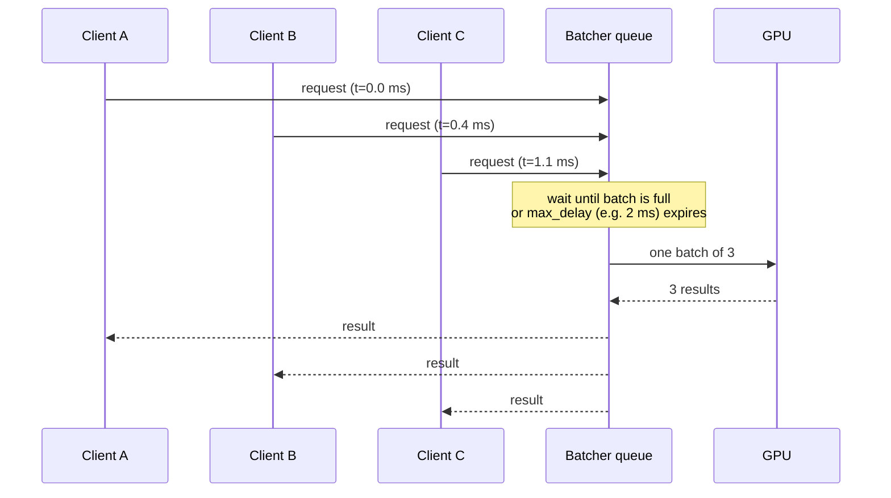

---

## Architecture

### Target design

Every component in this diagram is implemented (✅).

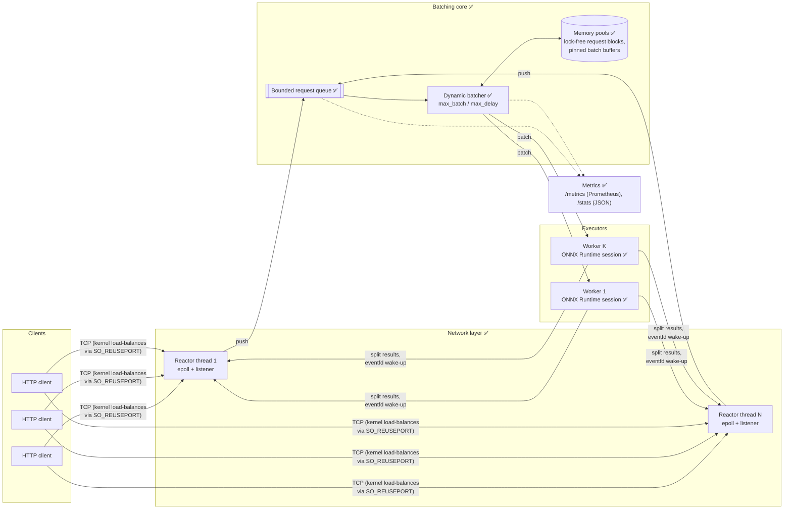

**Life of a request:**

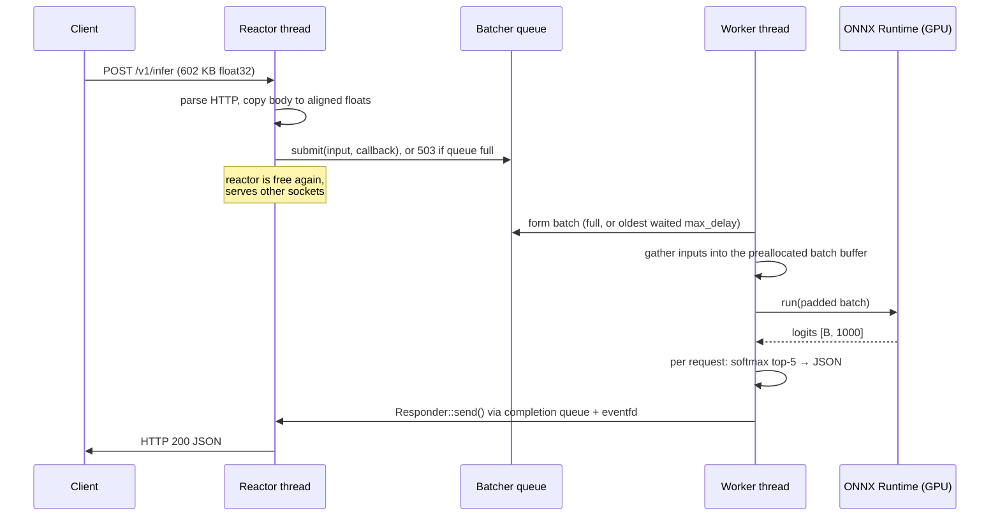

### Network layer (`src/net/`)

A from-scratch HTTP/1.1 server on Linux `epoll`, no networking libraries.

**Multi-reactor, no shared accept.** `HttpServer` starts N reactor threads.
Each one owns an epoll instance and its *own* listening socket bound to the same
port with `SO_REUSEPORT`, so the kernel spreads incoming connections across
reactors. Nothing is shared between reactors on the hot path. A connection
lives on one reactor for its whole life.

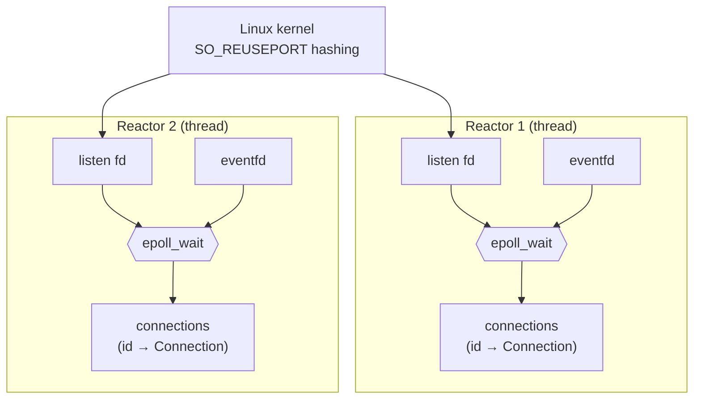

**Edge-triggered I/O.** Client sockets are registered once with
`EPOLLIN | EPOLLOUT | EPOLLRDHUP | EPOLLET`. On every event the reactor reads
or writes until `EAGAIN`, so it never needs to re-arm with `epoll_ctl`.
`EPOLLOUT` only fires when a full socket buffer drains, which is exactly when a
partially written response should resume.

**Incremental parser.** `HttpParser` handles requests arriving in any number of
pieces, including one byte at a time. It remembers where it stopped scanning for
the end of headers, supports keep-alive and pipelining, answers
`Expect: 100-continue` (curl sends this for large uploads), and enforces limits:
431 for oversized headers, 413 for oversized bodies, 501 for chunked uploads,
505 for unknown HTTP versions.

**Per-connection state machine:**

```mermaid
stateDiagram-v2
    [*] --> Reading: accept4()
    Reading --> Reading: partial request (need more bytes)
    Reading --> Handling: request complete → dispatch to handler
    Handling --> Writing: Responder::send() (any thread)
    Writing --> Writing: socket buffer full → wait for EPOLLOUT
    Writing --> Reading: keep-alive → parse next (pipelined) request
    Writing --> [*]: Connection: close / parse error
    Reading --> [*]: peer closed / error
    Handling --> [*]: peer closed (response dropped)
```

While a request is being handled the connection parses nothing else, so
pipelined requests are answered strictly in order. Extra input is buffered up
to one maximum-size request, then reading pauses until the response is written.

**Answering from any thread.** A handler gets a `Responder`, a small copyable
handle holding *(reactor, connection id)*. `send()` can be called from any
thread. This is what lets the batcher, running on worker threads, finish
requests later:

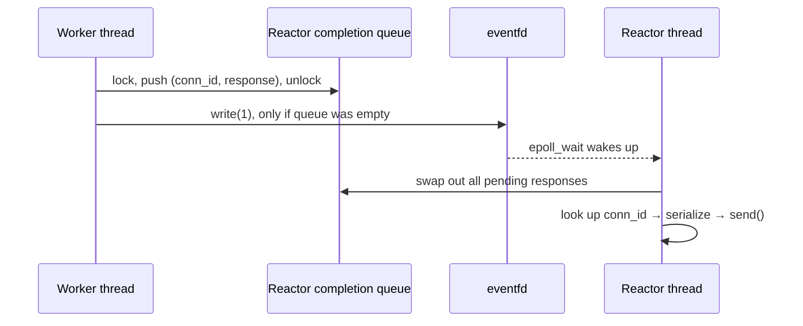

Connections are looked up by a 64-bit id, never by pointer or fd. If a client
disconnects before its response is ready, the lookup just fails and the
response is dropped: no use-after-free, and no confusion when the kernel
reuses the fd number. Only the first completion after a drain writes to the
eventfd, so a burst of results costs one syscall to wake the loop.

### Dynamic batcher (`src/batching/`)

`DynamicBatcher` turns single-image requests from many reactor threads into
batches and runs them on K worker threads. Each worker owns one model backend
and a batch input/output buffer allocated once at startup.

**When does a batch run?** As soon as either:

1. `max_batch_size` requests are waiting (run now, don't wait), or
2. the *oldest* waiting request has waited `max_queue_delay` (default 2 ms).

The delay is measured from the oldest request's arrival, not from when the
worker started looking. A request that already waited behind the previous
batch goes out immediately instead of waiting another 2 ms.

**One leader at a time.** Only one idle worker, the leader, waits on the
queue. The others wait for leadership. When the leader takes its batch it gives
up leadership and goes to compute, and the next worker immediately starts
collecting. So while one batch runs on the GPU, the next is already forming:

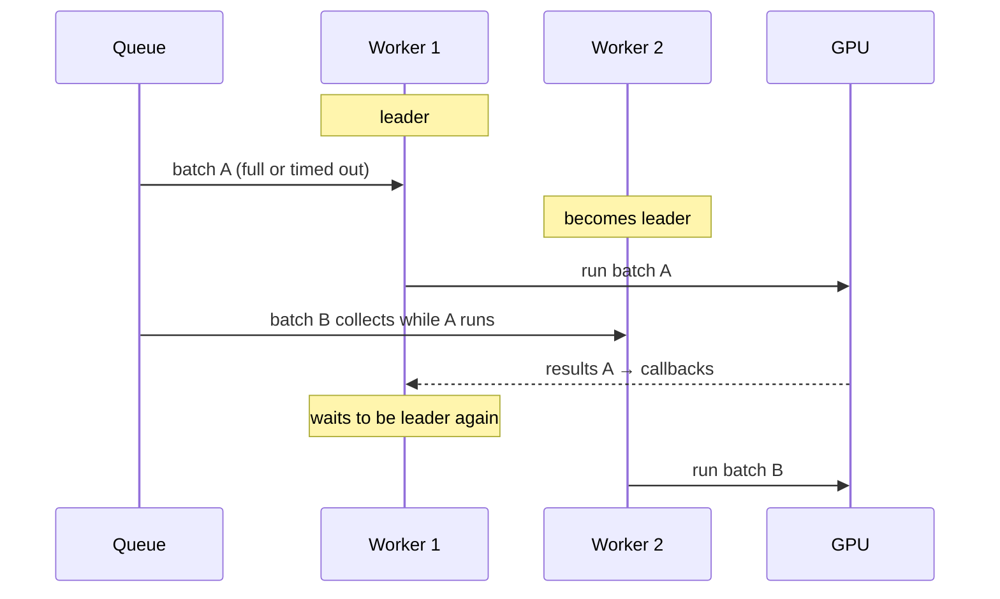

Because only the leader ever waits on the condition variable, `submit()` can
use `notify_one()`, and it only notifies on the two transitions the leader
cares about: queue became non-empty (start the delay clock) and batch is now
full (run immediately). Other submits make no wake-up call at all.

**Backpressure and failure handling:**

- **Bounded queue:** beyond `--queue-size` waiting requests, `submit()`
  refuses and the client gets **503**. Overload sheds load instead of growing
  memory and latency without bound.
- **Queue timeout:** with `--queue-timeout-ms`, requests that waited too long
  are failed with **504** before wasting GPU time on them.
- **Errors:** if the backend throws, every request in that batch gets 500. A
  throwing callback is caught so it can't kill the worker.
- **Shutdown:** `stop()` refuses new work, flushes everything queued without
  waiting out the delay, and joins the workers. The server stops the batcher
  *before* the HTTP layer, because callbacks deliver through the reactors.

**`--max-batch 1` turns batching off** while keeping exactly the same
pipeline, which is how the "off" rows in [Results](#results) were measured.

### Memory: pools and the data path (`src/memory/`)

Every request carries a 602 KB tensor. Allocating that per request means
`malloc` of large blocks (often `mmap`/`munmap` plus page faults) on the hot
path, on every thread. Instead, **no tensor-sized buffer is allocated after
startup**:

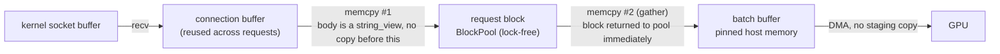

**`BlockPool`: lock-free, fixed-size blocks.** One slab is allocated at
startup and cut into cache-line-aligned blocks. The free list is a Treiber
stack. Its head is a single 64-bit atomic packing a 32-bit block index with a
32-bit version tag, so acquire and release are each one compare-and-swap with
no locks. The tag defeats the classic ABA bug: if another thread pops and
pushes back the same block between this thread's load and its CAS, the tag
has changed and the CAS fails instead of corrupting the list.

- **RAII handles.** `BlockPool::Block` is move-only and returns itself to the
  pool on destruction, so leaks are impossible by construction.
- **LIFO reuse.** The block released most recently is handed out next, while
  it's still warm in cache and TLB. Blocks never used never get physical pages,
  so a large pool costs nothing until load needs it.
- **Bounded memory.** The pool holds `queue_size + workers × max_batch` blocks.
  When it's empty the request gets 503, so memory has a hard ceiling even under
  overload.
- **Early return.** The batcher returns each request's block right after
  copying it into the batch buffer, *before* the model runs, so a block is held
  for microseconds instead of a whole inference.

**Zero-copy HTTP body.** The parser hands handlers the body as a
`std::string_view` into the connection's receive buffer, which keeps its
capacity across keep-alive requests. The connection erases the bytes only
after the handler returns.

**Pinned batch buffers.** `ModelBackend::allocate_host_buffer()` lets the
backend choose where batch buffers live. On CUDA, `OnnxBackend` returns
page-locked memory from ONNX Runtime's `CudaPinned` allocator. A copy from
pageable memory has to be staged by the driver through an internal pinned
buffer; from pinned memory the GPU can DMA directly.

| 64 clients, batching on | Throughput | p50 | p99 |
|---|---:|---:|---:|
| pageable batch buffers (`--pinned 0`) | 1,551 req/s | 44.9 ms | 50.4 ms |
| **pinned batch buffers** (default) | **1,912 req/s** | **35.3 ms** | **41.7 ms** |

Pool tests include an 8-thread stress test hammering a 4-block pool
(160,000 acquire/write/verify/release cycles). It checks that no block is
ever held by two threads and that all blocks come back, and it passes under
ThreadSanitizer.

### Metrics (`src/metrics/`, `src/server/`)

The server measures itself. `GET /stats` returns JSON over a sliding window
(`?window=N` seconds, default 10, max 60). `GET /metrics` returns the same data
in Prometheus text format. Here is `/stats` captured on the GPU server under
48 concurrent clients:

```json
{
  "window_s": 5.4, "uptime_s": 6.4,
  "throughput_rps": 1771.1,
  "requests": {"ok": 9624, "bad_request": 0, "rejected": 0, "timeouts": 0, "errors": 0},
  "latency_ms":       {"count": 9624, "mean": 24.4, "p50": 24.4, "p90": 25.5, "p99": 27.5, "p999": 33.1, "max": 36.9},
  "queue_wait_ms":    {"count": 9624, "mean": 6.8,  "p50": 6.8,  "p90": 7.9,  "p99": 8.6,  "p999": 20.2, "max": 22.5},
  "batch_compute_ms": {"count": 608,  "mean": 15.9, "p50": 16.0, "p90": 16.3, "p99": 18.1, "p999": 22.9, "max": 23.6},
  "batching": {"batches": 608, "avg_batch_size": 15.83, "padding_waste": 0.001,
               "batch_sizes": {"2": 2, "3": 2, "4": 2, "6": 1, "8": 1, "10": 1, "14": 1, "16": 598}},
  "queue_depth": 10, "inflight": 42, "connections": 49,
  "request_pool": {"in_use": 10, "capacity": 1056, "high_watermark": 27}
}
```

From this one response you can read off how the server spends its time.
Requests wait ~7 ms for a batch, then the batch takes ~16 ms. 98% of batches
are full, padding wastes 0.1% of GPU rows, and the request pool never needed
more than 27 of its 1,056 blocks.

| What | Kind | Where it's recorded |
|---|---|---|
| End-to-end latency (successful requests) | histogram | service: request parsed → response handed to reactor |
| Queue wait | histogram | batcher, per request: submit → batch formed |
| Batch compute | histogram | batcher, per batch: model `run()` |
| Batch size, padding waste | exact histogram, counter | batcher, per batch |
| Requests by status (200/400/500/503/504) | counters | service |
| Queue depth, in-flight, active connections, pool usage | gauges | read live at scrape time |
| Throughput | derived | ok-count delta ÷ window |

**Lock-free log-linear histogram.** `LatencyHistogram` works like
HdrHistogram. Values below 16 µs get exact buckets, and every power-of-two range
above is split into 16 equal sub-buckets. So no bucket is wider than 1/16 of
its lower edge, and percentiles are within **6.25%** from microseconds to
minutes, using 592 buckets. `record()` is three relaxed `fetch_add`s: no lock,
no CAS loop. A unit test checks p50 through p99.9 against exact values from a
200,000-sample log-normal distribution.

**Sliding windows without locking the hot path.** A ticker thread snapshots
every histogram and counter once a second into a 60-second ring.
Histograms subtract bucket-by-bucket, so the stats for "the last N seconds" are
just `live snapshot − ring snapshot from N seconds ago`:

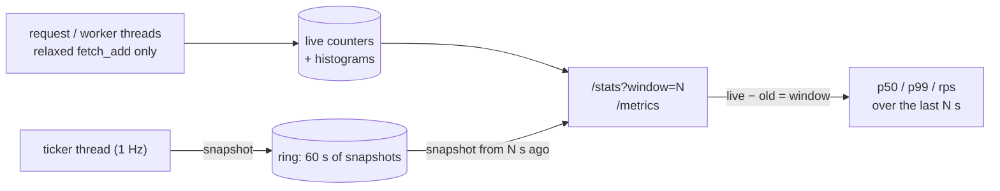

Latencies go to Prometheus as **summaries** with p50/p90/p99/p99.9 over the
last 60 s, plus cumulative `_sum` and `_count` so `rate()` works. Batch size is
a real Prometheus **histogram** with one bucket per size.

### Model runtime (`src/runtime/`)

`ModelBackend` is the interface the server sees: run *B* samples from a
caller-owned input buffer into a caller-owned output buffer.

`OnnxBackend` implements it with ONNX Runtime 1.30:

- It reads input and output shapes from the model and requires dimension 0 to
  be a dynamic batch dimension.
- `Ort::Value::CreateTensor` wraps the caller's memory directly, so tensor
  data is never copied or allocated by the backend; the batcher's pinned
  buffers are used in place.
- `--device cuda` attaches the CUDA execution provider. The CUDA/cuDNN
  runtime comes from pip wheels, so no system CUDA toolkit is needed.

**Batch-size buckets: the bug that halved GPU throughput.** The first batched
benchmark was *slower* than unbatched at 16 clients (297 vs 652 req/s). The
server reports per-request `queue_us` / `compute_us`, and these showed a batch
of 4 taking **38 ms** in the server against 3.6 ms in `ort_smoke`. The
difference: `ort_smoke` repeated one batch size, while the server's batch size
changes almost every run. ONNX Runtime's CUDA convolutions redo per-layer
setup whenever the input shape differs from the session's previous run.
`ort_smoke` now measures this:

| Run pattern (GPU) | ms per run |
|---|---:|
| 4, 4, 4, … | 4.8 |
| 8, 8, 8, … | 4.8 |
| 4, 8, 4, 8, … | **35.2** |

The fix: each worker holds **one session per batch-size bucket** (1, 2, 4, 8,
16), and batches are padded up to the next bucket. Each session only ever sees
one shape. This is the same idea as Triton's preferred batch sizes or TensorRT
optimization profiles. Padding 5 → 8 costs far less on a GPU than a 30 ms
reshape. After the fix a batch of 4 takes 6 ms in the server and throughput at
16 clients went from 297 to 1,184 req/s.

On CPU the same experiment shows no penalty (4,8,4,8 averages exactly between
4,4 and 8,8), and padding costs real compute there. So `--buckets auto` uses
power-of-two buckets on CUDA and none on CPU.

`models/export_resnet.py` exports torchvision's ResNet-18 with a dynamic batch
dimension and saves a reference batch. `ort_smoke` checks C++ outputs against
PyTorch: max difference 5e-6 on CPU, 5e-3 on GPU (TF32 convolutions), with
identical top-1 classes.

### Graceful shutdown

`SIGTERM` (what Docker and Kubernetes send) and `SIGINT` are blocked in every
thread and received synchronously by `main` via `sigwait`, so no
async-signal-safety problems arise. Shutdown then drains instead of dropping
work:

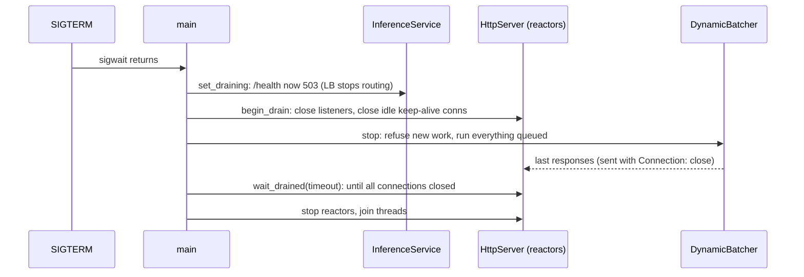

Busy connections finish their in-flight request and close right after it.
Order matters: the batcher stops before the reactors, because its callbacks
deliver through them. Measured on the GPU server under 64 connections of load,
SIGTERM to exit took 1.3 s with no failed in-flight requests. The drain is
bounded by `--drain-timeout-ms` (default 10 s). A unit test covers it: an
in-flight request completes with `Connection: close`, idle connections are
closed, and new connections are refused.

---

## API

| Method | Path | Body | Response |
|---|---|---|---|
| `GET` | `/health` | — | `ok` |
| `GET` | `/stats` | `?window=N` (1–60 s, default 10) | JSON: windowed latency percentiles, throughput, batching, gauges ([example](#metrics-srcmetrics-srcserver)) |
| `GET` | `/metrics` | — | Prometheus text exposition |
| `POST` | `/v1/infer` | one image as raw little-endian float32, shape 3×224×224 (602,112 bytes), ImageNet-normalized | see below |

```json
{"top_k":[{"class":281,"prob":0.412},{"class":285,"prob":0.187}, ...],
 "batch_size":12, "queue_us":1830, "compute_us":8204}
```

`top_k` is the top 5 classes with softmax probabilities. `batch_size` is how
many requests ran together, `queue_us` is how long this request waited before
its batch formed, and `compute_us` is the model run time for the whole batch.

| Status | Meaning |
|---|---|
| 400 | body is not exactly 602,112 bytes |
| 503 | request queue full (overload); retry later |
| 504 | waited longer than `--queue-timeout-ms` |
| 500 | model execution failed |

```bash
python - <<'EOF'
import numpy as np, urllib.request
x = np.fromfile("models/ref_input.bin", np.float32)[:3*224*224]
print(urllib.request.urlopen("http://localhost:8080/v1/infer", data=x.tobytes()).read().decode())
EOF
```

---

## Build and run

Target platform: Linux (Ubuntu 22.04, developed on WSL2).

```bash
bash scripts/setup_wsl.sh          # one-time: compilers, cmake, ninja (sudo)
bash scripts/fetch_onnxruntime.sh  # prebuilt ONNX Runtime into third_party/
bash scripts/setup_python.sh       # venv with PyTorch (CPU) for model export
source ~/.venvs/cpp_ml_inference_server/bin/activate
python models/export_resnet.py     # resnet18.onnx + reference batch

cmake -S . -B build -G Ninja -DCMAKE_BUILD_TYPE=Release
cmake --build build
./build/inference_server --model models/resnet18.onnx --port 8080
python scripts/infer_client.py --port 8080      # correctness check + quick load test
```

> On WSL2, keep the build directory on the Linux filesystem (e.g.
> `-B ~/builds/infer`) rather than under `/mnt/c`. It compiles faster and
> avoids Windows file locks breaking CMake's FetchContent.

### GPU build (NVIDIA, CUDA 12)

```bash
ORT_FLAVOR=gpu bash scripts/fetch_onnxruntime.sh
bash scripts/setup_cuda.sh          # CUDA/cuDNN runtime as pip wheels, no sudo
cmake -S . -B build-cuda -G Ninja -DCMAKE_BUILD_TYPE=Release -DINFER_ENABLE_CUDA=ON
cmake --build build-cuda
. scripts/env_cuda.sh               # puts cuDNN/cuBLAS on LD_LIBRARY_PATH
./build-cuda/inference_server --model models/resnet18.onnx --device cuda
```

### Server flags

| Flag | Default | Meaning |
|---|---|---|
| `--model` | `models/resnet18.onnx` | ONNX model path |
| `--device` | `cpu` | `cpu` or `cuda` |
| `--port` | `8080` | listen port |
| `--reactors` | `2` | epoll reactor (network) threads |
| `--workers` | `2` | batch executor threads, each with its own model sessions |
| `--ort-threads` | `1` | ONNX Runtime intra-op threads per session (CPU) |
| `--max-batch` | `16` | largest batch; `1` disables batching |
| `--max-delay-us` | `2000` | longest the oldest request waits for a batch to fill |
| `--queue-size` | `1024` | waiting requests before new ones get 503 |
| `--queue-timeout-ms` | `0` (off) | fail requests that waited longer with 504 |
| `--buckets` | `auto` | batch-size buckets: `auto` (powers of two on CUDA, none on CPU), `none`, or a list like `1,4,16` |
| `--pinned` | `1` | CUDA pinned batch buffers (`0` = pageable, for comparison) |
| `--drain-timeout-ms` | `10000` | graceful-shutdown budget for in-flight requests |
| `--web` | off | serve the browser demo from this directory (e.g. `web`) |

---

## Deployment: Docker, Prometheus, Grafana, CI

**Docker.** Multi-stage images: the build stage compiles against the prebuilt
ONNX Runtime, and the runtime stage holds just the binaries, `libonnxruntime`
and the model, running as a non-root user with a `HEALTHCHECK` on `/health`.
The CUDA image is based on `nvidia/cuda:*-cudnn-runtime` and needs no CUDA
toolkit to build.

```bash
python models/export_resnet.py                      # the image bundles models/resnet18.onnx
docker build -t inference-server .                  # CPU
docker run --rm -p 8080:8080 inference-server

docker build -f Dockerfile.cuda -t inference-server:cuda .
docker run --rm --gpus all -p 8080:8080 inference-server:cuda
```

Both images were built and tested. Inside Docker (Docker Desktop on WSL2) the
CUDA image serves **1,633 req/s at p99 41.7 ms** with 64 connections (close to
native), and `docker stop` triggers the graceful drain (`drained cleanly`,
exit 0). The CUDA runtime in the base image must be recent enough for the ONNX
Runtime build: with ORT 1.30, a CUDA 12.9 base works while 12.6 fails to load the
CUDA provider (missing `cudaLibraryGetKernel`).

**Prometheus + Grafana.** `docker compose up --build` starts the server,
Prometheus scraping `/metrics` every 2 s, and Grafana at
<http://localhost:3000> with a provisioned **Inference Server** dashboard:
throughput, p50/p99/p99.9 latency, queue-wait vs compute time, average batch
size, queue depth and in-flight requests, error rates by status, pool usage and
padding waste. If port 8080 is taken, use `INFER_PORT=18080 docker compose up --build`. GPU variant:
`INFER_DOCKERFILE=Dockerfile.cuda docker compose -f docker-compose.yml -f deploy/compose.gpu.yml up --build`.

**CI.** `.github/workflows/ci.yml` builds and runs the unit tests in three
configurations on every push: release (GCC), AddressSanitizer + UBSan (GCC),
and ThreadSanitizer (clang).

---

## Benchmarking

`loadgen` is a C++ load generator built alongside the server. It reuses the
server's lock-free histogram.

```bash
# Closed loop: 64 connections, each sends its next request when the last returns
./build/loadgen --port 8080 --mode closed --connections 64 --duration 10 --input models/ref_input.bin
# Open loop: Poisson arrivals at 1,500 req/s spread over 256 connections
./build/loadgen --port 8080 --mode open --rate 1500 --connections 256 --duration 10
# --json prints one machine-readable line
```

**Why open loop matters.** A closed-loop tool only sends a new request after
the previous one returns. If the server stalls for 100 ms, the tool stops
sending for 100 ms too, and those would-be requests never get measured. This is
*coordinated omission*, and it makes tails look far better than users
experience. In open-loop mode, `loadgen` schedules arrivals in advance (Poisson
process) and measures each request from its *scheduled* time, so a stall
counts against every request it delayed. It also reports "late starts" when
all connections were busy at a scheduled time.

The full suite (concurrency sweep, offered-load sweep, delay sweep, CPU
comparison) and the charts:

```bash
. scripts/env_cuda.sh                                        # GPU runs need the CUDA libraries on the path
python bench/run_benchmarks.py --build ~/builds/infer-cuda   # ~10 min, writes bench/results/*.json
python bench/plot_results.py                                 # writes docs/images/*.png
```

---

## Testing

```bash
ctest --test-dir build --output-on-failure      # or ./build/unit_tests
```

- **HTTP parser:** byte-at-a-time delivery, pipelining, keep-alive rules,
  `100-continue`, and every error status.
- **Server integration:** real sockets against a server on an ephemeral port.
  Covers keep-alive, in-order pipelining with an async handler, 1 MiB bodies
  arriving in pieces, 404/405, malformed input (400 and close), clients
  disconnecting mid-request, and 32 concurrent clients.
- **Block pool:** distinct aligned blocks, exhaustion, no overlap, LIFO
  reuse, RAII and move semantics, a custom (pinned-style) allocator, and an
  8-thread contention stress test.
- **Histograms:** exact small buckets, bucket bounds and width over random
  magnitudes, percentile accuracy against exact values, window subtraction,
  and concurrent recording.
- **HTTP API end to end** (real sockets, fake model): top-k JSON, 400, 503 on
  pool exhaustion, `/stats` counts and window exclusion of old traffic, and
  `/metrics` format validation (every sample line parses).
- **Dynamic batcher**, with a fake backend that records batch sizes: a lone
  request waits about `max_delay`; a full batch runs without waiting; each of 40
  callers gets its own result; padding rows are ignored; 503 when the queue is
  full; `stop()` drains without waiting; backend failure fails the whole
  batch; queue timeouts; and 8 producers × 3 workers × 1,600 requests.
- **Graceful drain:** in-flight request completes with `Connection: close`,
  idle connections close, new connections are refused.
- **Sanitizers:** the same suite under AddressSanitizer + UBSan
  (`-DINFER_ENABLE_ASAN=ON`) and ThreadSanitizer (`-DINFER_ENABLE_TSAN=ON`).

> **ThreadSanitizer notes.** Build TSan with clang
> (`CC=clang CXX=clang++`). GCC 11's TSan runtime doesn't intercept
> `pthread_cond_clockwait`, which `condition_variable::wait_until` uses, so it
> reports false "double lock" errors. On newer kernels, run TSan binaries
> under `setarch $(uname -m) -R` (disables ASLR) to avoid "unexpected memory
> mapping" failures.

---

## Project layout

```
├── apps/
│   ├── server_main.cpp        inference server executable
│   ├── loadgen.cpp            C++ load generator (closed / open loop)
│   └── ort_smoke.cpp          C++ vs PyTorch check + batch-size timing
├── include/infer/
│   ├── batching/              dynamic_batcher.hpp
│   ├── memory/                block_pool.hpp (lock-free fixed-size blocks)
│   ├── metrics/               histogram.hpp (lock-free log-linear histogram, counters)
│   ├── net/                   http.hpp (parser, types), http_server.hpp
│   ├── runtime/               model_backend.hpp, onnx_backend.hpp
│   └── server/                inference_service.hpp (HTTP API, /stats, /metrics), web_demo.hpp
├── src/
│   ├── batching/              dynamic_batcher.cpp
│   ├── memory/                block_pool.cpp
│   ├── metrics/               histogram.cpp
│   ├── net/                   http.cpp, http_server.cpp (reactors)
│   ├── runtime/               onnx_backend.cpp (incl. batch-size buckets)
│   └── server/                inference_service.cpp, web_demo.cpp
├── tests/                     GoogleTest: pool, batcher, histogram, parser, server, API
├── bench/                     run_benchmarks.py, plot_results.py, results/*.json
├── docs/images/               benchmark charts, web demo screenshot
├── web/                       browser demo (index.html, ImageNet labels.json)
├── models/                    export_resnet.py (PyTorch → ONNX + reference data)
├── scripts/                   environment setup, CUDA env, infer_client.py
├── deploy/                    Prometheus config, Grafana provisioning + dashboard
├── Dockerfile, Dockerfile.cuda, docker-compose.yml
├── .github/workflows/ci.yml   build + tests: release, ASan/UBSan, TSan
└── third_party/               ONNX Runtime (downloaded, git-ignored)
```

---

## Design lessons

Things that only showed up by measuring or testing, each now covered by a test
or documented:

- **Shapes cost more than batch size.** ONNX Runtime's CUDA convolutions redo
  per-layer setup whenever a session sees a new input shape (~30 ms for
  ResNet-18). Varying batch sizes thrashed it until each bucket got its own
  session. Found by having the server report `compute_us` per request.
- **Pageable vs pinned memory is worth 23%.** At full load the host→device
  copies of 16 × 602 KB per batch matter; page-locked buffers let the GPU DMA
  directly.
- **ADL can silently bypass your code.** A helper named `invoke(callback, ...)`
  was never called: argument-dependent lookup on `std::function` picked
  `std::invoke`, skipping the helper's exception guard. A compiler "unused
  function" warning was the only clue.
- **Static destruction order and CUDA.** A function-local static `Ort::Env`
  can be destroyed after the CUDA runtime unloads at exit. It is intentionally
  leaked.
- **Sanitizer false positives are toolchain bugs, not your bugs:** GCC 11's
  TSan doesn't intercept `pthread_cond_clockwait` (used by
  `condition_variable::wait_until` on `steady_clock`), so it reported a phantom
  double lock. Clang's TSan is clean.
- **`SO_REUSEPORT` accepts strangers.** It lets *any* process of the same
  user bind the port, so a second server instance silently took half the
  connections (found while testing the web demo against an older instance).
  The server now probes the port without `SO_REUSEPORT` first and refuses to
  start if it's taken. A regression test covers this.
- **Batching has a cost at low load.** At one connection, a lone request waits
  the full batching delay. That's the price of capacity under load, made
  explicit in the results instead of hidden.

## Limitations and future work

- **One model per process**, fixed input shape (dynamic batch dimension only).
  Multi-model routing and model versioning would follow the Triton model
  repository pattern.
- **HTTP/1.1 only**, no TLS (expected behind a proxy or load balancer). A
  gRPC/HTTP-2 frontend could reuse the batcher unchanged.
- **Adaptive batching delay:** skip the wait when the GPU is idle and no other
  request is in flight. This would remove the single-client latency penalty.
- **CUDA graphs** per batch bucket (the shapes are already static per session)
  and **TensorRT / FP16** would cut per-batch GPU time further.
- **Benchmark caveats:** client and server share one machine, and a laptop GPU
  changes clocks with load and temperature. Numbers are representative, not
  datacenter figures.

---

## Roadmap

- [x] Phase 0: toolchain, ONNX Runtime, ResNet-18 export
- [x] Phase 1: C++ inference matches PyTorch (CPU + CUDA)
- [x] Phase 2: epoll HTTP server, unbatched baseline
- [x] Phase 3: request queue + dynamic batcher + worker completion path
- [x] Phase 4: memory pools (no per-request tensor allocation) + pinned memory
- [x] Phase 5: `/metrics` (Prometheus) and `/stats` (JSON)
- [x] Phase 6: C++ load generator (closed + open loop) and benchmark suite with charts
- [x] Phase 7: graceful shutdown (drain), Docker images, Prometheus + Grafana, GitHub Actions CI
