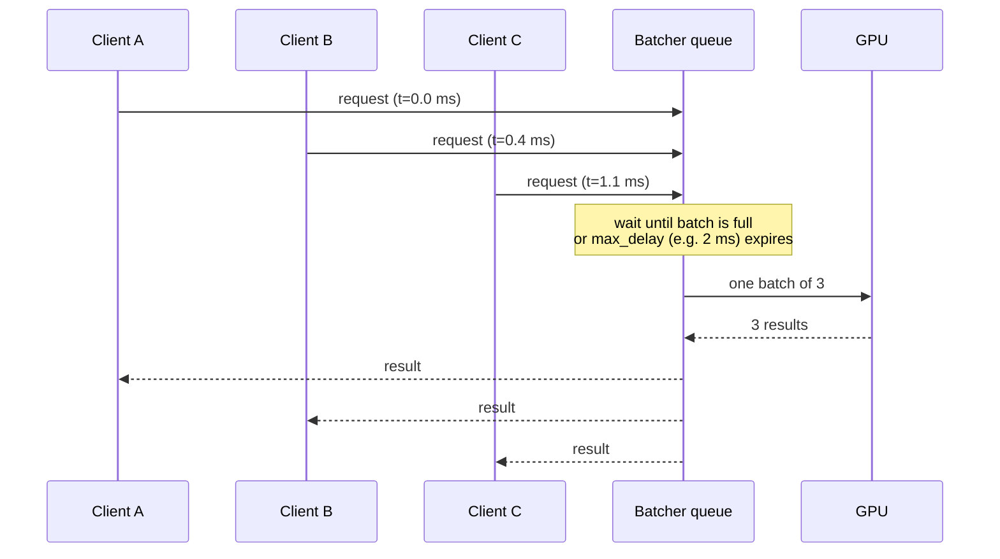
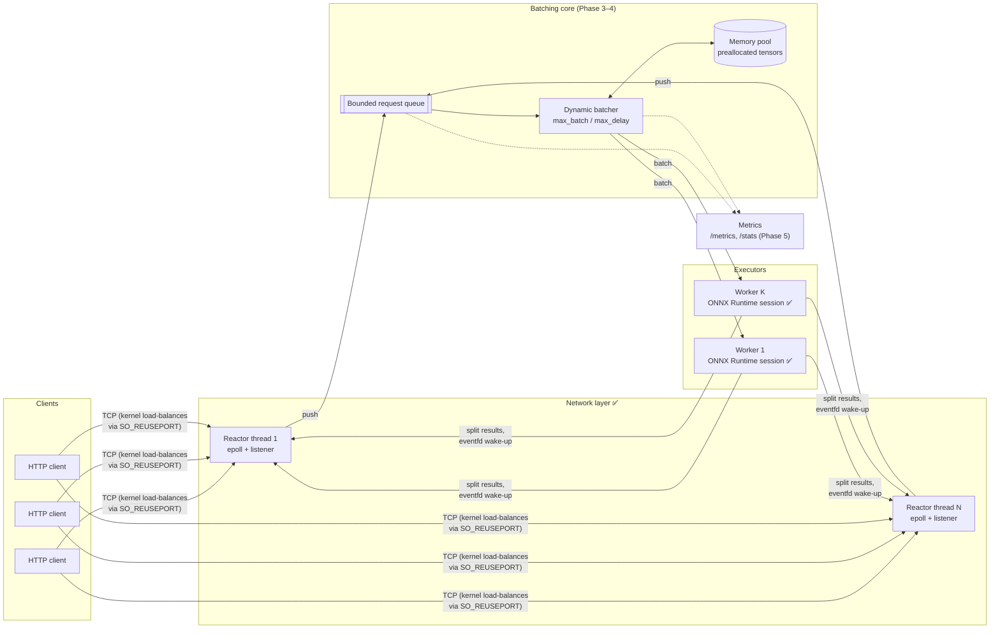
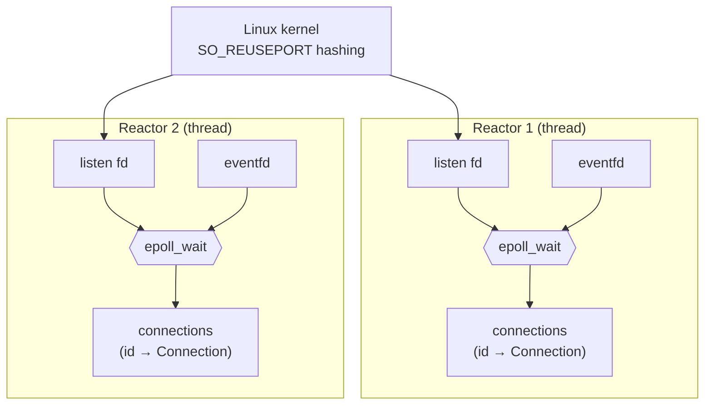
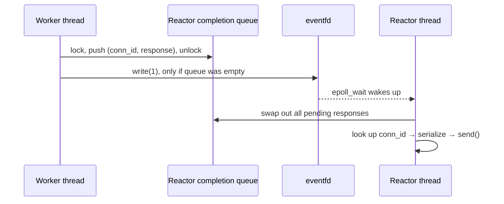

# C++ ML Inference Server

A model-serving server written from scratch in C++20: a custom **epoll HTTP/1.1
stack**, **dynamic batching** (the technique behind NVIDIA Triton and vLLM),
preallocated memory pools, ONNX Runtime execution on CPU or **CUDA GPU**, and a
metrics endpoint with p50/p99 latency, throughput, queue depth and batch sizes.

> **Status: Phase 2 done** — multi-reactor epoll HTTP server serving ResNet-18
> (unbatched baseline). Next: the dynamic batcher. See [Roadmap](#roadmap).

---

## Contents

- [Why batching?](#why-batching)
- [Architecture](#architecture)
  - [Target design](#target-design)
  - [Network layer](#network-layer-srcnet)
  - [Model runtime](#model-runtime-srcruntime)
- [API](#api)
- [Build and run](#build-and-run)
- [Testing](#testing)
- [Project layout](#project-layout)
- [Roadmap](#roadmap)

---

## Why batching?

Measured with `ort_smoke` (ResNet-18, one ONNX Runtime call per batch):

| Batch | CPU, 4 threads: ms/image | GPU (RTX 4060 Laptop): ms/image | GPU images/s |
|------:|------:|------:|------:|
| 1  | 14.8 | 3.53 | 283 |
| 4  | 14.2 | 0.90 | 1,116 |
| 16 | 14.6 | 0.59 | **1,698** |
| 64 | —    | 0.64 | 1,574 |

On CPU the per-image cost is flat: the convolutions are compute-bound, so a
batch has nothing to amortize. On the GPU, a single image leaves most of the
chip idle; running 16 together gives **6× the throughput**.

But clients send one image each. The server's job is to turn many concurrent
single-image requests into GPU-sized batches without making anyone wait long.
That is dynamic batching:



---

## Architecture

### Target design

Components marked ✅ are implemented; the rest are upcoming phases.



**Today (Phase 2)** the batching core is not there yet: each reactor thread runs
the model inline on its own session, one request at a time. That is the
*unbatched baseline* every later phase is measured against.

**Phase 2 baseline**: 4 reactors and 4 sessions, 16 concurrent keep-alive
clients for 5 s (`scripts/infer_client.py`):

| Device | Throughput | p50 | p90 | p99 |
|---|---:|---:|---:|---:|
| CPU (4 × 1 ORT thread) | 68.7 req/s | 257 ms | 340 ms | 372 ms |
| GPU, RTX 4060 Laptop | 611 req/s | 27.1 ms | 37.1 ms | 49.2 ms |

The GPU baseline already beats one session's 283 images/s because 4 sessions
overlap on the GPU. It is still far below the ~1,700 images/s the GPU reaches
on batches of 16. (These numbers come from a Python client; the C++ load
generator in Phase 6 will give the definitive comparison.)

### Network layer (`src/net/`)

A from-scratch HTTP/1.1 server on Linux `epoll`, no networking libraries.

**Multi-reactor, no shared accept.** `HttpServer` starts N reactor threads.
Each one owns an epoll instance and its *own* listening socket bound to the same
port with `SO_REUSEPORT`, so the kernel spreads incoming connections across
reactors. Nothing is shared between reactors on the hot path. A connection
lives on one reactor for its whole life.



**Edge-triggered I/O.** Client sockets are registered once with
`EPOLLIN | EPOLLOUT | EPOLLRDHUP | EPOLLET`. On every event the reactor reads
or writes until `EAGAIN`, so it never needs to re-arm with `epoll_ctl`.
`EPOLLOUT` only fires when a full socket buffer drains, which is exactly when a
partially written response should resume.

**Incremental parser.** `HttpParser` handles requests arriving in any number of
pieces, including one byte at a time. It remembers where it stopped scanning for
the end of headers, supports keep-alive and pipelining, answers
`Expect: 100-continue` (curl sends this for large uploads), and enforces limits:
431 for oversized headers, 413 for oversized bodies, 501 for chunked uploads,
505 for unknown HTTP versions.

**Per-connection state machine:**

```mermaid
stateDiagram-v2
    [*] --> Reading: accept4()
    Reading --> Reading: partial request (need more bytes)
    Reading --> Handling: request complete → dispatch to handler
    Handling --> Writing: Responder::send() (any thread)
    Writing --> Writing: socket buffer full → wait for EPOLLOUT
    Writing --> Reading: keep-alive → parse next (pipelined) request
    Writing --> [*]: Connection: close / parse error
    Reading --> [*]: peer closed / error
    Handling --> [*]: peer closed (response dropped)
```

While a request is being handled the connection parses nothing else, so
pipelined requests are answered strictly in order. Extra input is buffered up
to one maximum-size request, then reading pauses until the response is written.

**Answering from any thread.** A handler gets a `Responder`, a small copyable
handle holding *(reactor, connection id)*. `send()` can be called from any
thread. This is what lets the batcher, running on worker threads, finish
requests later:



Connections are looked up by a 64-bit id, never by pointer or fd. If a client
disconnects before its response is ready, the lookup just fails and the
response is dropped: no use-after-free, and no confusion when the kernel
reuses the fd number. Only the first completion after a drain writes to the
eventfd, so a burst of results costs one syscall to wake the loop.

### Model runtime (`src/runtime/`)

`ModelBackend` is the interface the server sees: run *B* samples from a
caller-owned input buffer into a caller-owned output buffer.

`OnnxBackend` implements it with ONNX Runtime 1.30:

- It reads input and output shapes from the model and requires dimension 0 to
  be a dynamic batch dimension.
- `Ort::Value::CreateTensor` wraps the caller's memory directly, so tensor
  data is never copied or allocated by the backend. Later, the memory pool
  plugs straight in here.
- `--device cuda` attaches the CUDA execution provider. The CUDA/cuDNN
  runtime comes from pip wheels, so no system CUDA toolkit is needed.

`models/export_resnet.py` exports torchvision's ResNet-18 with a dynamic batch
dimension and saves a reference batch. `ort_smoke` checks C++ outputs against
PyTorch: max difference 5e-6 on CPU, 5e-3 on GPU (TF32 convolutions), with
identical top-1 classes.

---

## API

| Method | Path | Body | Response |
|---|---|---|---|
| `GET` | `/health` | — | `ok` |
| `POST` | `/v1/infer` | one image as raw little-endian float32, shape 3×224×224 (602,112 bytes), ImageNet-normalized | `{"top_k":[{"class":281,"prob":0.41},…]}` (top 5, softmax) |

```bash
python - <<'EOF'
import numpy as np, urllib.request
x = np.fromfile("models/ref_input.bin", np.float32)[:3*224*224]
print(urllib.request.urlopen("http://localhost:8080/v1/infer", data=x.tobytes()).read().decode())
EOF
```

---

## Build and run

Target platform: Linux (Ubuntu 22.04, developed on WSL2).

```bash
bash scripts/setup_wsl.sh          # one-time: compilers, cmake, ninja (sudo)
bash scripts/fetch_onnxruntime.sh  # prebuilt ONNX Runtime into third_party/
bash scripts/setup_python.sh       # venv with PyTorch (CPU) for model export
source ~/.venvs/cpp_ml_inference_server/bin/activate
python models/export_resnet.py     # resnet18.onnx + reference batch

cmake -S . -B build -G Ninja -DCMAKE_BUILD_TYPE=Release
cmake --build build
./build/inference_server --model models/resnet18.onnx --port 8080 --reactors 4
python scripts/infer_client.py --port 8080      # correctness check + quick load test
```

> On WSL2, keep the build directory on the Linux filesystem (e.g.
> `-B ~/builds/infer`) rather than under `/mnt/c`. It compiles faster and
> avoids Windows file locks breaking CMake's FetchContent.

### GPU build (NVIDIA, CUDA 12)

```bash
ORT_FLAVOR=gpu bash scripts/fetch_onnxruntime.sh
bash scripts/setup_cuda.sh          # CUDA/cuDNN runtime as pip wheels, no sudo
cmake -S . -B build-cuda -G Ninja -DCMAKE_BUILD_TYPE=Release -DINFER_ENABLE_CUDA=ON
cmake --build build-cuda
. scripts/env_cuda.sh               # puts cuDNN/cuBLAS on LD_LIBRARY_PATH
./build-cuda/inference_server --model models/resnet18.onnx --device cuda
```

### Server flags

| Flag | Default | Meaning |
|---|---|---|
| `--model` | `models/resnet18.onnx` | ONNX model path |
| `--device` | `cpu` | `cpu` or `cuda` |
| `--port` | `8080` | listen port |
| `--reactors` | `4` | epoll reactor threads (and, in Phase 2, model sessions) |
| `--ort-threads` | `1` | ONNX Runtime intra-op threads per session (CPU) |

---

## Testing

```bash
ctest --test-dir build --output-on-failure      # or ./build/unit_tests
```

- **HTTP parser:** byte-at-a-time delivery, pipelining, keep-alive rules,
  `100-continue`, and every error status.
- **Server integration:** real sockets against a server on an ephemeral port.
  Covers keep-alive, in-order pipelining with an async handler, 1 MiB bodies
  arriving in pieces, 404/405, malformed input (400 and close), clients
  disconnecting mid-request, and 32 concurrent clients.
- **Sanitizers:** the same suite under AddressSanitizer + UBSan
  (`-DINFER_ENABLE_ASAN=ON`) and ThreadSanitizer (`-DINFER_ENABLE_TSAN=ON`).

---

## Project layout

```
├── apps/
│   ├── server_main.cpp        inference server executable
│   └── ort_smoke.cpp          C++ vs PyTorch check + batch-size timing
├── include/infer/
│   ├── net/                   http.hpp (parser, types), http_server.hpp
│   └── runtime/               model_backend.hpp, onnx_backend.hpp
├── src/
│   ├── net/                   http.cpp, http_server.cpp (reactors)
│   └── runtime/               onnx_backend.cpp
├── tests/                     GoogleTest: parser + server integration
├── models/                    export_resnet.py (PyTorch → ONNX + reference data)
├── scripts/                   environment setup, CUDA env, infer_client.py
└── third_party/               ONNX Runtime (downloaded, git-ignored)
```

---

## Roadmap

- [x] Phase 0: toolchain, ONNX Runtime, ResNet-18 export
- [x] Phase 1: C++ inference matches PyTorch (CPU + CUDA)
- [x] Phase 2: epoll HTTP server, unbatched baseline
- [ ] Phase 3: request queue + dynamic batcher + worker completion path
- [ ] Phase 4: memory pools, multiple executor workers
- [ ] Phase 5: `/metrics` (Prometheus) and `/stats` (JSON)
- [ ] Phase 6: load generator and benchmarks (batching on vs off)
- [ ] Phase 7: Docker, CI, graceful shutdown
