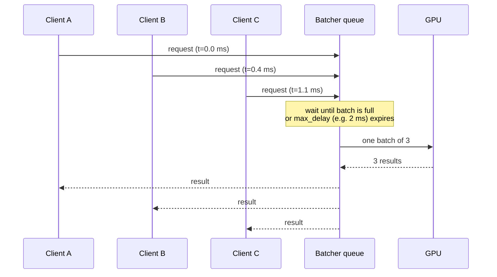
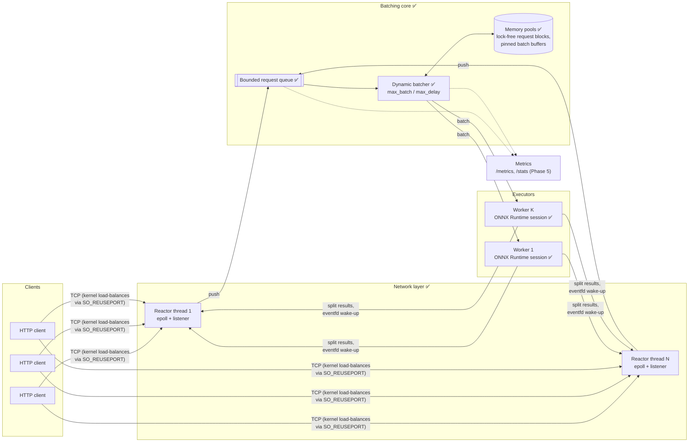
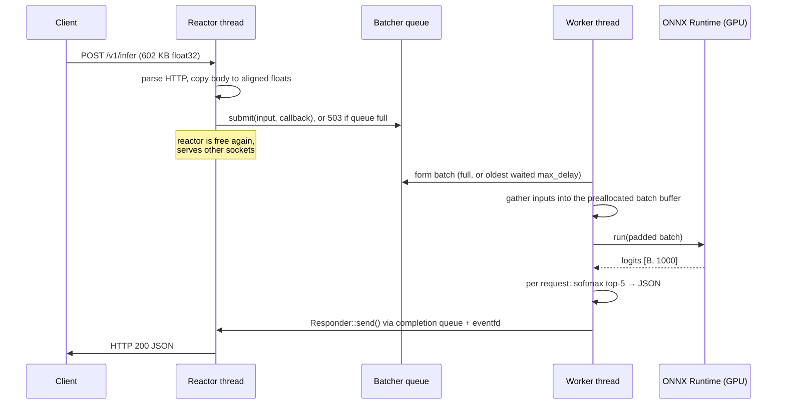
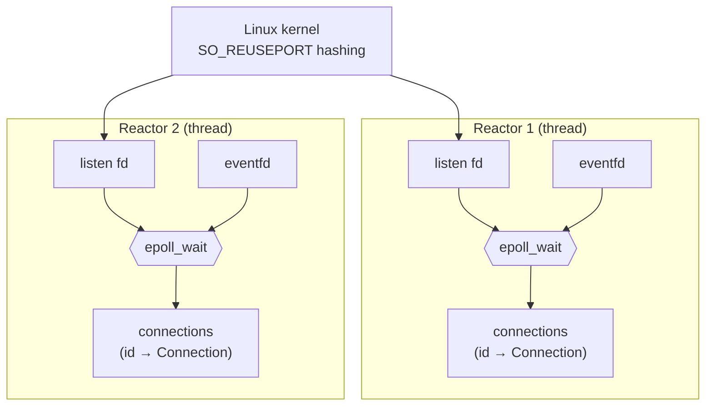
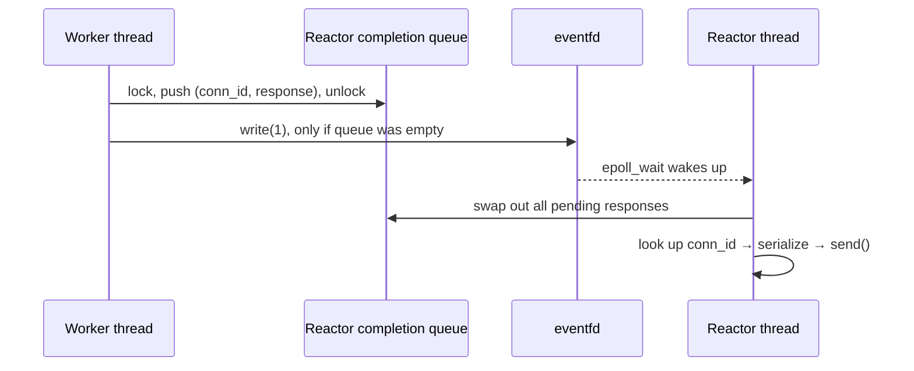
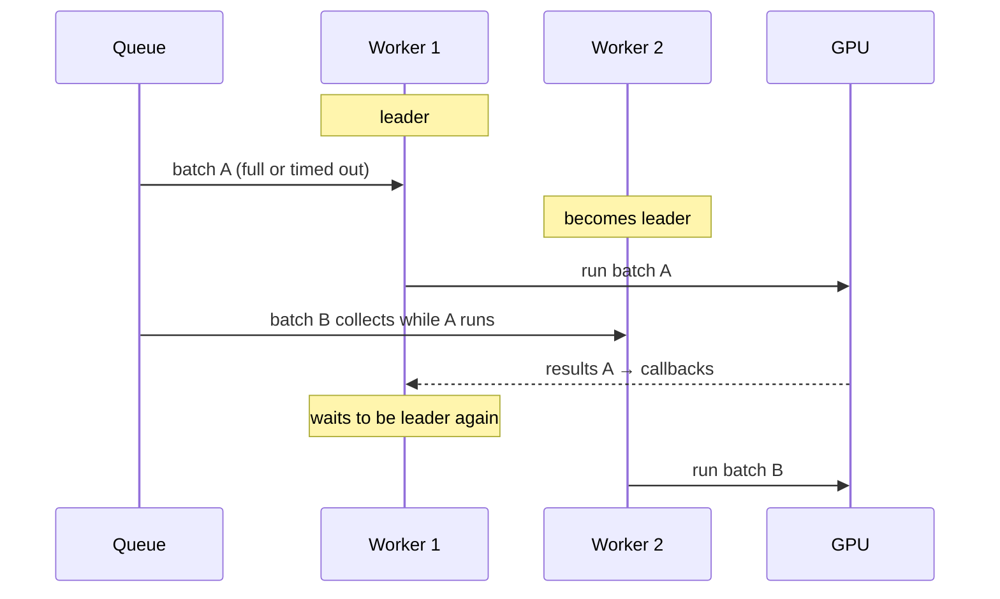
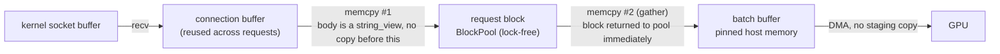

# C++ ML Inference Server

A model-serving server written from scratch in C++20: a custom **epoll HTTP/1.1
stack**, **dynamic batching** (the technique behind NVIDIA Triton and vLLM),
preallocated memory pools, ONNX Runtime execution on CPU or **CUDA GPU**, and a
metrics endpoint with p50/p99 latency, throughput, queue depth and batch sizes.

> **Status: Phase 4 done.** Dynamic batching plus pinned, pooled memory serves
> **1,912 req/s on one laptop GPU (2.9× unbatched), with p99 latency down from
> 126 ms to 42 ms**. Next: metrics. See [Roadmap](#roadmap).

---

## Contents

- [Results](#results)
- [Why batching?](#why-batching)
- [Architecture](#architecture)
  - [Target design](#target-design)
  - [Network layer](#network-layer-srcnet)
  - [Dynamic batcher](#dynamic-batcher-srcbatching)
  - [Memory: pools and the data path](#memory-pools-and-the-data-path-srcmemory)
  - [Model runtime](#model-runtime-srcruntime)
- [API](#api)
- [Build and run](#build-and-run)
- [Testing](#testing)
- [Project layout](#project-layout)
- [Roadmap](#roadmap)

---

## Results

ResNet-18 on an RTX 4060 Laptop GPU, closed-loop keep-alive clients sending
one image per request for 6 s (`scripts/infer_client.py`, 8 client processes).
"Off" is the same server with `--max-batch 1 --workers 4`; "on" uses
`--max-batch 16 --max-delay-us 2000 --workers 2`.

| Clients | Batching | Throughput | p50 | p90 | p99 | Avg batch |
|---:|---|---:|---:|---:|---:|---:|
| 16 | off | 652 req/s | 25.7 ms | 30.9 ms | 37.0 ms | 1.0 |
| 16 | **on** | **1,184 req/s** | **14.4 ms** | **16.3 ms** | **19.3 ms** | 10.2 |
| 64 | off | 665 req/s | 103.3 ms | 110.8 ms | 126.0 ms | 1.0 |
| 64 | on | 1,537 req/s | 44.5 ms | 46.5 ms | 49.2 ms | 16.0 |
| 64 | **on + pinned memory** (Phase 4) | **1,912 req/s** | **35.3 ms** | **37.9 ms** | **41.7 ms** | 16.0 |

Batching lowers latency as well as raising throughput: unbatched requests
queue behind each other one image at a time, while a batch of 16 takes about
9 ms on the GPU. Pinned batch buffers then add another 23% at full load by
making host→GPU copies direct DMA. (A dedicated C++ load generator comes in
Phase 6.)

A larger `--max-batch 32` was *slower* at 64 clients (1,240 req/s): batches
averaged 23 requests and got padded to 32, and bigger batches mean longer
waits. Max batch size is a tuning knob, not "bigger is better".

---

## Why batching?

Measured with `ort_smoke` (ResNet-18, one ONNX Runtime call per batch):

| Batch | CPU, 4 threads: ms/image | GPU (RTX 4060 Laptop): ms/image | GPU images/s |
|------:|------:|------:|------:|
| 1  | 14.8 | 3.53 | 283 |
| 4  | 14.2 | 0.90 | 1,116 |
| 16 | 14.6 | 0.59 | **1,698** |
| 64 | —    | 0.64 | 1,574 |

On CPU the per-image cost is flat: the convolutions are compute-bound, so a
batch has nothing to amortize. On the GPU, a single image leaves most of the
chip idle; running 16 together gives **6× the throughput**.

But clients send one image each. The server's job is to turn many concurrent
single-image requests into GPU-sized batches without making anyone wait long.
That is dynamic batching:



---

## Architecture

### Target design

Components marked ✅ are implemented; the rest are upcoming phases.



**Life of a request:**



### Network layer (`src/net/`)

A from-scratch HTTP/1.1 server on Linux `epoll`, no networking libraries.

**Multi-reactor, no shared accept.** `HttpServer` starts N reactor threads.
Each one owns an epoll instance and its *own* listening socket bound to the same
port with `SO_REUSEPORT`, so the kernel spreads incoming connections across
reactors. Nothing is shared between reactors on the hot path. A connection
lives on one reactor for its whole life.



**Edge-triggered I/O.** Client sockets are registered once with
`EPOLLIN | EPOLLOUT | EPOLLRDHUP | EPOLLET`. On every event the reactor reads
or writes until `EAGAIN`, so it never needs to re-arm with `epoll_ctl`.
`EPOLLOUT` only fires when a full socket buffer drains, which is exactly when a
partially written response should resume.

**Incremental parser.** `HttpParser` handles requests arriving in any number of
pieces, including one byte at a time. It remembers where it stopped scanning for
the end of headers, supports keep-alive and pipelining, answers
`Expect: 100-continue` (curl sends this for large uploads), and enforces limits:
431 for oversized headers, 413 for oversized bodies, 501 for chunked uploads,
505 for unknown HTTP versions.

**Per-connection state machine:**

```mermaid
stateDiagram-v2
    [*] --> Reading: accept4()
    Reading --> Reading: partial request (need more bytes)
    Reading --> Handling: request complete → dispatch to handler
    Handling --> Writing: Responder::send() (any thread)
    Writing --> Writing: socket buffer full → wait for EPOLLOUT
    Writing --> Reading: keep-alive → parse next (pipelined) request
    Writing --> [*]: Connection: close / parse error
    Reading --> [*]: peer closed / error
    Handling --> [*]: peer closed (response dropped)
```

While a request is being handled the connection parses nothing else, so
pipelined requests are answered strictly in order. Extra input is buffered up
to one maximum-size request, then reading pauses until the response is written.

**Answering from any thread.** A handler gets a `Responder`, a small copyable
handle holding *(reactor, connection id)*. `send()` can be called from any
thread. This is what lets the batcher, running on worker threads, finish
requests later:



Connections are looked up by a 64-bit id, never by pointer or fd. If a client
disconnects before its response is ready, the lookup just fails and the
response is dropped: no use-after-free, and no confusion when the kernel
reuses the fd number. Only the first completion after a drain writes to the
eventfd, so a burst of results costs one syscall to wake the loop.

### Dynamic batcher (`src/batching/`)

`DynamicBatcher` turns single-image requests from many reactor threads into
batches and runs them on K worker threads. Each worker owns one model backend
and a batch input/output buffer allocated once at startup.

**When does a batch run?** As soon as either:

1. `max_batch_size` requests are waiting (run now, don't wait), or
2. the *oldest* waiting request has waited `max_queue_delay` (default 2 ms).

The delay is measured from the oldest request's arrival, not from when the
worker started looking. A request that already waited behind the previous
batch goes out immediately instead of waiting another 2 ms.

**One leader at a time.** Only one idle worker, the leader, waits on the
queue. The others wait for leadership. When the leader takes its batch it gives
up leadership and goes to compute, and the next worker immediately starts
collecting. So while one batch runs on the GPU, the next is already forming:



Because only the leader ever waits on the condition variable, `submit()` can
use `notify_one()`, and it only notifies on the two transitions the leader
cares about: queue became non-empty (start the delay clock) and batch is now
full (run immediately). Other submits make no wake-up call at all.

**Backpressure and failure handling:**

- **Bounded queue:** beyond `--queue-size` waiting requests, `submit()`
  refuses and the client gets **503**. Overload sheds load instead of growing
  memory and latency without bound.
- **Queue timeout:** with `--queue-timeout-ms`, requests that waited too long
  are failed with **504** before wasting GPU time on them.
- **Errors:** if the backend throws, every request in that batch gets 500. A
  throwing callback is caught so it can't kill the worker.
- **Shutdown:** `stop()` refuses new work, flushes everything queued without
  waiting out the delay, and joins the workers. The server stops the batcher
  *before* the HTTP layer, because callbacks deliver through the reactors.

**`--max-batch 1` turns batching off** while keeping exactly the same
pipeline, which is how the "off" rows in [Results](#results) were measured.

### Memory: pools and the data path (`src/memory/`)

Every request carries a 602 KB tensor. Allocating that per request means
`malloc` of large blocks (often `mmap`/`munmap` plus page faults) on the hot
path, on every thread. Instead, **no tensor-sized buffer is allocated after
startup**:



**`BlockPool`: lock-free, fixed-size blocks.** One slab is allocated at
startup and cut into cache-line-aligned blocks. The free list is a Treiber
stack. Its head is a single 64-bit atomic packing a 32-bit block index with a
32-bit version tag, so acquire and release are each one compare-and-swap with
no locks. The tag defeats the classic ABA bug: if another thread pops and
pushes back the same block between this thread's load and its CAS, the tag
has changed and the CAS fails instead of corrupting the list.

- **RAII handles.** `BlockPool::Block` is move-only and returns itself to the
  pool on destruction, so leaks are impossible by construction.
- **LIFO reuse.** The block released most recently is handed out next, while
  it's still warm in cache and TLB. Blocks never used never get physical pages,
  so a large pool costs nothing until load needs it.
- **Bounded memory.** The pool holds `queue_size + workers × max_batch` blocks.
  When it's empty the request gets 503, so memory has a hard ceiling even under
  overload.
- **Early return.** The batcher returns each request's block right after
  copying it into the batch buffer, *before* the model runs, so a block is held
  for microseconds instead of a whole inference.

**Zero-copy HTTP body.** The parser hands handlers the body as a
`std::string_view` into the connection's receive buffer, which keeps its
capacity across keep-alive requests. The connection erases the bytes only
after the handler returns.

**Pinned batch buffers.** `ModelBackend::allocate_host_buffer()` lets the
backend choose where batch buffers live. On CUDA, `OnnxBackend` returns
page-locked memory from ONNX Runtime's `CudaPinned` allocator. A copy from
pageable memory has to be staged by the driver through an internal pinned
buffer; from pinned memory the GPU can DMA directly.

| 64 clients, batching on | Throughput | p50 | p99 |
|---|---:|---:|---:|
| pageable batch buffers (`--pinned 0`) | 1,551 req/s | 44.9 ms | 50.4 ms |
| **pinned batch buffers** (default) | **1,912 req/s** | **35.3 ms** | **41.7 ms** |

Pool tests include an 8-thread stress test hammering a 4-block pool
(160,000 acquire/write/verify/release cycles). It checks that no block is
ever held by two threads and that all blocks come back, and it passes under
ThreadSanitizer.

### Model runtime (`src/runtime/`)

`ModelBackend` is the interface the server sees: run *B* samples from a
caller-owned input buffer into a caller-owned output buffer.

`OnnxBackend` implements it with ONNX Runtime 1.30:

- It reads input and output shapes from the model and requires dimension 0 to
  be a dynamic batch dimension.
- `Ort::Value::CreateTensor` wraps the caller's memory directly, so tensor
  data is never copied or allocated by the backend; the batcher's pinned
  buffers are used in place.
- `--device cuda` attaches the CUDA execution provider. The CUDA/cuDNN
  runtime comes from pip wheels, so no system CUDA toolkit is needed.

**Batch-size buckets: the bug that halved GPU throughput.** The first batched
benchmark was *slower* than unbatched at 16 clients (297 vs 652 req/s). The
server reports per-request `queue_us` / `compute_us`, and these showed a batch
of 4 taking **38 ms** in the server against 3.6 ms in `ort_smoke`. The
difference: `ort_smoke` repeated one batch size, while the server's batch size
changes almost every run. ONNX Runtime's CUDA convolutions redo per-layer
setup whenever the input shape differs from the session's previous run.
`ort_smoke` now measures this:

| Run pattern (GPU) | ms per run |
|---|---:|
| 4, 4, 4, … | 4.8 |
| 8, 8, 8, … | 4.8 |
| 4, 8, 4, 8, … | **35.2** |

The fix: each worker holds **one session per batch-size bucket** (1, 2, 4, 8,
16), and batches are padded up to the next bucket. Each session only ever sees
one shape. This is the same idea as Triton's preferred batch sizes or TensorRT
optimization profiles. Padding 5 → 8 costs far less on a GPU than a 30 ms
reshape. After the fix a batch of 4 takes 6 ms in the server and throughput at
16 clients went from 297 to 1,184 req/s.

On CPU the same experiment shows no penalty (4,8,4,8 averages exactly between
4,4 and 8,8), and padding costs real compute there. So `--buckets auto` uses
power-of-two buckets on CUDA and none on CPU.

`models/export_resnet.py` exports torchvision's ResNet-18 with a dynamic batch
dimension and saves a reference batch. `ort_smoke` checks C++ outputs against
PyTorch: max difference 5e-6 on CPU, 5e-3 on GPU (TF32 convolutions), with
identical top-1 classes.

---

## API

| Method | Path | Body | Response |
|---|---|---|---|
| `GET` | `/health` | — | `ok` |
| `POST` | `/v1/infer` | one image as raw little-endian float32, shape 3×224×224 (602,112 bytes), ImageNet-normalized | see below |

```json
{"top_k":[{"class":281,"prob":0.412},{"class":285,"prob":0.187}, ...],
 "batch_size":12, "queue_us":1830, "compute_us":8204}
```

`top_k` is the top 5 classes with softmax probabilities. `batch_size` is how
many requests ran together, `queue_us` is how long this request waited before
its batch formed, and `compute_us` is the model run time for the whole batch.

| Status | Meaning |
|---|---|
| 400 | body is not exactly 602,112 bytes |
| 503 | request queue full (overload); retry later |
| 504 | waited longer than `--queue-timeout-ms` |
| 500 | model execution failed |

```bash
python - <<'EOF'
import numpy as np, urllib.request
x = np.fromfile("models/ref_input.bin", np.float32)[:3*224*224]
print(urllib.request.urlopen("http://localhost:8080/v1/infer", data=x.tobytes()).read().decode())
EOF
```

---

## Build and run

Target platform: Linux (Ubuntu 22.04, developed on WSL2).

```bash
bash scripts/setup_wsl.sh          # one-time: compilers, cmake, ninja (sudo)
bash scripts/fetch_onnxruntime.sh  # prebuilt ONNX Runtime into third_party/
bash scripts/setup_python.sh       # venv with PyTorch (CPU) for model export
source ~/.venvs/cpp_ml_inference_server/bin/activate
python models/export_resnet.py     # resnet18.onnx + reference batch

cmake -S . -B build -G Ninja -DCMAKE_BUILD_TYPE=Release
cmake --build build
./build/inference_server --model models/resnet18.onnx --port 8080
python scripts/infer_client.py --port 8080      # correctness check + quick load test
```

> On WSL2, keep the build directory on the Linux filesystem (e.g.
> `-B ~/builds/infer`) rather than under `/mnt/c`. It compiles faster and
> avoids Windows file locks breaking CMake's FetchContent.

### GPU build (NVIDIA, CUDA 12)

```bash
ORT_FLAVOR=gpu bash scripts/fetch_onnxruntime.sh
bash scripts/setup_cuda.sh          # CUDA/cuDNN runtime as pip wheels, no sudo
cmake -S . -B build-cuda -G Ninja -DCMAKE_BUILD_TYPE=Release -DINFER_ENABLE_CUDA=ON
cmake --build build-cuda
. scripts/env_cuda.sh               # puts cuDNN/cuBLAS on LD_LIBRARY_PATH
./build-cuda/inference_server --model models/resnet18.onnx --device cuda
```

### Server flags

| Flag | Default | Meaning |
|---|---|---|
| `--model` | `models/resnet18.onnx` | ONNX model path |
| `--device` | `cpu` | `cpu` or `cuda` |
| `--port` | `8080` | listen port |
| `--reactors` | `2` | epoll reactor (network) threads |
| `--workers` | `2` | batch executor threads, each with its own model sessions |
| `--ort-threads` | `1` | ONNX Runtime intra-op threads per session (CPU) |
| `--max-batch` | `16` | largest batch; `1` disables batching |
| `--max-delay-us` | `2000` | longest the oldest request waits for a batch to fill |
| `--queue-size` | `1024` | waiting requests before new ones get 503 |
| `--queue-timeout-ms` | `0` (off) | fail requests that waited longer with 504 |
| `--buckets` | `auto` | batch-size buckets: `auto` (powers of two on CUDA, none on CPU), `none`, or a list like `1,4,16` |
| `--pinned` | `1` | CUDA pinned batch buffers (`0` = pageable, for comparison) |

---

## Testing

```bash
ctest --test-dir build --output-on-failure      # or ./build/unit_tests
```

- **HTTP parser:** byte-at-a-time delivery, pipelining, keep-alive rules,
  `100-continue`, and every error status.
- **Server integration:** real sockets against a server on an ephemeral port.
  Covers keep-alive, in-order pipelining with an async handler, 1 MiB bodies
  arriving in pieces, 404/405, malformed input (400 and close), clients
  disconnecting mid-request, and 32 concurrent clients.
- **Block pool:** distinct aligned blocks, exhaustion, no overlap, LIFO
  reuse, RAII and move semantics, a custom (pinned-style) allocator, and an
  8-thread contention stress test.
- **Dynamic batcher**, with a fake backend that records batch sizes: a lone
  request waits about `max_delay`; a full batch runs without waiting; each of 40
  callers gets its own result; padding rows are ignored; 503 when the queue is
  full; `stop()` drains without waiting; backend failure fails the whole
  batch; queue timeouts; and 8 producers × 3 workers × 1,600 requests.
- **Sanitizers:** the same suite under AddressSanitizer + UBSan
  (`-DINFER_ENABLE_ASAN=ON`) and ThreadSanitizer (`-DINFER_ENABLE_TSAN=ON`).

> **ThreadSanitizer notes.** Build TSan with clang
> (`CC=clang CXX=clang++`). GCC 11's TSan runtime doesn't intercept
> `pthread_cond_clockwait`, which `condition_variable::wait_until` uses, so it
> reports false "double lock" errors. On newer kernels, run TSan binaries
> under `setarch $(uname -m) -R` (disables ASLR) to avoid "unexpected memory
> mapping" failures.

---

## Project layout

```
├── apps/
│   ├── server_main.cpp        inference server executable
│   └── ort_smoke.cpp          C++ vs PyTorch check + batch-size timing
├── include/infer/
│   ├── batching/              dynamic_batcher.hpp
│   ├── memory/                block_pool.hpp (lock-free fixed-size blocks)
│   ├── net/                   http.hpp (parser, types), http_server.hpp
│   └── runtime/               model_backend.hpp, onnx_backend.hpp
├── src/
│   ├── batching/              dynamic_batcher.cpp
│   ├── memory/                block_pool.cpp
│   ├── net/                   http.cpp, http_server.cpp (reactors)
│   └── runtime/               onnx_backend.cpp (incl. batch-size buckets)
├── tests/                     GoogleTest: block pool, batcher, parser, server integration
├── models/                    export_resnet.py (PyTorch → ONNX + reference data)
├── scripts/                   environment setup, CUDA env, infer_client.py
└── third_party/               ONNX Runtime (downloaded, git-ignored)
```

---

## Roadmap

- [x] Phase 0: toolchain, ONNX Runtime, ResNet-18 export
- [x] Phase 1: C++ inference matches PyTorch (CPU + CUDA)
- [x] Phase 2: epoll HTTP server, unbatched baseline
- [x] Phase 3: request queue + dynamic batcher + worker completion path
- [x] Phase 4: memory pools (no per-request tensor allocation) + pinned memory
- [ ] Phase 5: `/metrics` (Prometheus) and `/stats` (JSON)
- [ ] Phase 6: load generator and benchmarks (batching on vs off)
- [ ] Phase 7: Docker, CI, graceful shutdown
